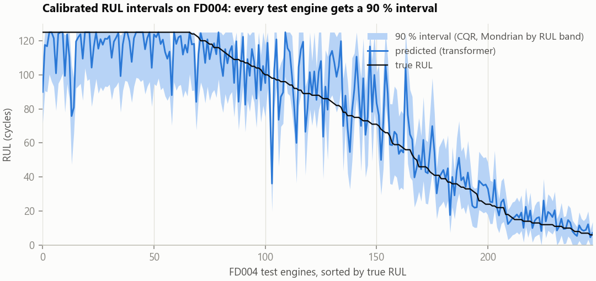

# turbofan-rul

Remaining-useful-life prediction for turbofan engines, with prediction intervals that can be
trusted. A point estimate on its own invites two expensive mistakes: replacing an engine
that is still healthy, or keeping one in service that is about to fail.

LSTM and transformer models are trained from scratch in PyTorch on NASA's C-MAPSS
benchmark, with quantile heads and conformalized quantile regression on top. Calibration is
done per group (Mondrian), by operating regime and by predicted-life band.

## Results

Test RMSE in cycles, lower is better:

| | FD001 | FD002 | FD003 | FD004 |
|---|---|---|---|---|
| LightGBM baseline | **12.12** | **13.96** | **12.27** | 14.89 |
| LSTM | 14.03 | 15.03 | 12.97 | 15.01 |
| Transformer | 13.71 | 14.70 | 13.04 | **14.27** |

LightGBM wins 3 of the 4 subsets. The deep models only come out ahead on FD004, the hardest
one, with 6 operating regimes and 2 fault modes.

The 90% intervals cover about 90% of test cases (0.87 to 0.89 measured, within binomial
noise). Because they are calibrated per predicted-life band, they are 11 to 19 cycles wide
when an engine looks close to failure and 36 to 45 cycles when it looks healthy, so they
are tightest where the decision is most urgent.

Full tables, NASA scores and the coverage analysis are in [docs/results.md](docs/results.md).

## Live API

`https://aao1ufi805.execute-api.eu-west-1.amazonaws.com`, with `GET /health`, `GET /models`
and `POST /predict`. It is serverless and throttled to 5 requests per second, so the first
call after a quiet spell waits a few seconds. The
[maintenance-qa-agent](https://github.com/mateus-aleixo/maintenance-qa-agent) calls it as
one of its tools. A sample request is in [docs/deploy.md](docs/deploy.md).

## How it's deployed

- Models are exported to ONNX and served by FastAPI on onnxruntime. Preprocessing and
  conformal state are stored as JSON, so the 359 MB image needs no PyTorch, scikit-learn
  or pickle.
- The same container runs on a laptop and on AWS Lambda, through the Lambda Web Adapter.
- Terraform provisions ECR, Lambda and API Gateway. GitHub Actions deploys through OIDC,
  with a role that can push images and update the function code but can't change the
  infrastructure.
- There is also a Helm chart. CI installs it on a kind cluster and checks that a rolling
  update and a killed pod drop no requests ([docs/kubernetes.md](docs/kubernetes.md)).

[docs/architecture.md](docs/architecture.md) and the [model card](docs/model-card.md) cover
the rest, including the limits: the data is simulated, and exchangeability only holds
approximately.

## Running it

    docker compose up --build             # serves the committed models, no GPU or torch
    curl localhost:8000/health

    pip install -e .[train,dev]           # or retrain everything, about 5 min on an RTX 3060
    python -m conformal_rul.data
    python -m conformal_rul.train --all
    python -m conformal_rul.conformal && python -m conformal_rul.export

MIT licence.
